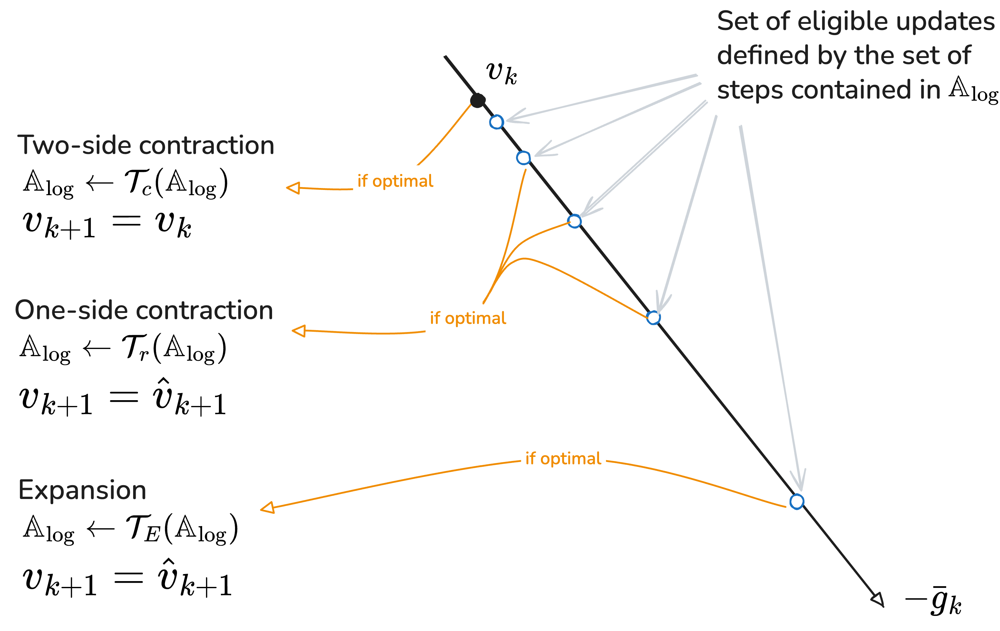
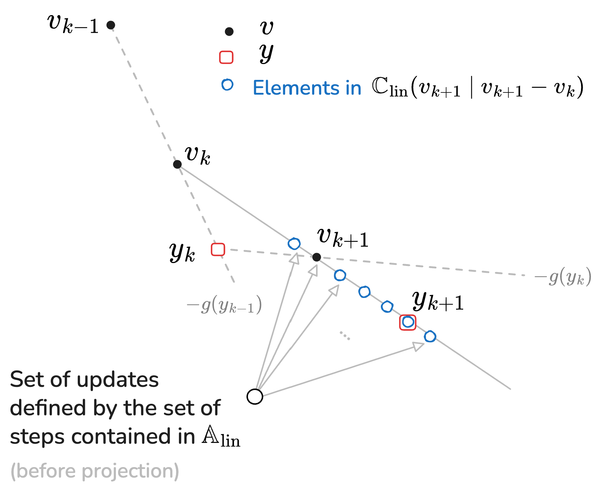

---

## Problem Statement {#problem}

`mizoGrad` is a python module that implements **Gradient-Based** solution to the following box-constrained optimization problems:

$$
\min_{x\in [\underline x, \bar x]}f(x, {\scriptsize \texttt{**kwargs}})
$${#eq-problem}

where $f$ is a differentiable map, $x$ is the decision variable while $\texttt{**kwargs}$ is a list of keywords arguments that is necessary to define the cost function. 

### Deterministic version 

In its deterministic version, the dictionary of parameters kwargs is given and a deterministic cost is defined accordingly. 

### Stochastic version 

In the stochastic version, the fields associated to the `key` used in the instantiation of the solver is uncertain and hence, different formulation of a constrained stochastic optimization problems can be defined, namely: 

- `Expectation`-related: where the cost function is the expectation of the cost 

- `Value-at-Risk (VaR)`: where the cost function to be minimized is defined as the $\alpha$-quantile of the cost function $f(x,p)$. 

- `Conditional-Value-at-Risk (CVaR)`: where the cost to be minimized represents the expectation of values that go beyonf the $\alpha$-quantile. 

:::{.callout-tip title="Deterministic version is used in the stochastic version"}
It is important to notice that the stochastic version of the algorithm leverages the acceleration features included in the determinisitc approach. This means that understanding the deterministic version's parameters and options is mandatory for a better use of the stochastic version. 

In the next sections, the deterministiv version is first introduced before its use in the stochastic version is discussed. 
:::

## The `GradOptimizer` class  {#deterministic}

This class implements the deterministic version and it is then used also in the stochastic version. The following section describes the main features of the deterministic algorithm that explains its high performance compared to other gradient-based algorithms. 

### Algorithm features {#features}

The Gradient-based algorithm used in the `mizoGrad` module is fully described in the [paper](https://arxiv.org/abs/2607.14600). This section just highlights some main features that distinguishes it from existing alternatives. 

The algorithm uses three main mechanisms that makes it outstanding, namely: 

- The use of line search along the gradient line which is defined through a specific adaptable grid. 
- The adaptation of the grid is based on a trust region mechanism
- Unlike the standard implementation of the Nesterov acceleration step, `mizoGrad` uses **another line search** along the acceleration path. Moreover, this line search allow for **negative** steps. 

This is schematically shown in the following Figures:

#### The gradient step 

{width=80%}

#### The acceleration step

{width=80%}


:::{.callout-important title="Provable convergence"}
Despite the use of both line search on the gradient direction and acceleration step, the algorithm is **proved to asymptotically converges** to a point that meets the KKT optimality condition (see the proof in the [reference paper](https://arxiv.org/abs/2607.14600)).
:::

### Syntax of use {#syntax}

In order to use the module, the user need to provide three **mandatory arguments*, namely:

- The python function for the cost function 
- The python function for its gradient 
- The number of decision variables. 

All the other parameters corresponds to some default values. In particular, if non `xmin` and `xmax` arguments are provided, the problem is considered to be unconstrained. 

The following section provides the full list of input arguments 

#### Input arguments 

The following list of arguments are used in the instantiation of `GradOptimizer` class. An instance of this class possesses a `solve` method that enables to solve the above mentioned problem @eq-problem.

:::{.callout-warning title="Order of the decision variable in f and g"}
Please notice that it is mandatory that **decision variable appears as the first argument in the formal definition of the cost function**.
:::

:::{.tbl-caption}
| **Parameter**     | **Description**      | **Default**|
|---|---------------|----:|
| `f` |  The python function that provides the cost function. This function might need the value of some dictionary of parameters so that the generic call is `f(x, **kwargs)` where `kwargs` is a dictionary (see the example below)| --|
| `g`| The python function that provides the gradient of the function. Similarly to the cost function This function might need the value of some dictionary of parameters so that the generic call is `f(x, **kwargs)` where `kwargs` is a dictionary (see the example below) | -- |
| `nx`| The number of decision variable (dimension of `x`) | -- |
| `xmin`| The lower bound on the vector of decition variable | `[-inf] * nx` |
| `xmax`| The upper bound on the vector of decition variable | `[+inf] * nx` |
| `ng`| The integer representing the number of adaptive grid for the line searched. As a matter of fact, the line search along the gradient line involves `ng+2` grid-points while the line search on the acceleration path uses `ng+1`. (See the reference for more details and this is so) | `5` |
| `alpha_min`| The initial value of the exponent of the smallest step on the gradient search, the default value means that the initial adaptable smallest step is $10^{-8}$. Notice that this is the smallest *adaptable* step size but not necessarily the smallest candidate step. This is because the `eta<1/(2L)` value (see below) is always there without change.  | `-8` |
| `alpha_max`| The initial value of the exponent of the largest step on the gradient search, the default value means that the initial adaptable largest step is $1$. **The values of the last two arguments are updated according to trust region-like mechanism** | `0` |
| `fast_min`| The smallest step along the acceleration line (no adaptation)| `-0.2` |
| `fast_max`| The largest step along the acceleration line (no adaptation) | `1.0` |
| `rho_adapt`| The adaptation ratio for the trust region mechanism | `0.05` |
| `eta`| The constant extremely small step size along the gradient. This value is not updated and is supposed (for the proof of convergence) to be lower than $1/(2L)$ where $L$ is the Lypschiz constant of the cost function. | `1e-16` |

Table: Input arguments for the `instantiation` of the `GradOptimizer` class.
:::

#### Calling the solve method 

The solve method is called on an instance of the `GradOptimizer` class with the following arguments 

- `x0`: The initial guess
- `kwargs`: The dictionary needed for the cost function and the gradient
- `maxIter`: The maximum number of allowed iterations (Default: `100`)
- `epsG`: The early stopping threshold on the norm of the gradient (Default: $10^{-8}$)
- `display`: Boolean for the display or not of intermediate results 


#### Returned dictionary 

The solver returns a dictionary with the following fields: 

:::{.tbl-caption}
| **Parameter**     | **Description** |
|---|---------------|----:|
| `xopt` |  The optimal solution found $\in \mathbb R^{n_x}$ | 
| `fopt`| The corresponding optimal value of the cost function | 
| `normG`| The norm of the gradient at the solution  |
| `lesalpha_min`| The history of the smallest exponents during the iterations | 
| `lesalpha_max`| The history of the largest exponents during the iterations  | 
| `traj`| The history of the cost function values during the iteration | 
| `traj_c`| The history of the acceleration step size  during the iterations|


Table: The returned dictionary by the `solve` method.
:::


### Example of use {#example}

This script gives a complete example of use of the `mizoGrad` module

```python
import numpy as np
from mizoGrad import GradOptimizer
from time import time

#from SaA import GradOptimizer

np.set_printoptions(formatter={'float': lambda x: "{0:0.4f}".format(x)})

# Define the cost function and the gradient

def cost(x, a=10, b=2, m=1):

    f = np.power((x[0]-a)*x[1] + b * x[2] ** 3, 2*m)
    return f

def cost_gradient(x, a=10, b=2, m=1):
    term = 4 * np.power((x[0]-a)*x[1] + b * x[2] ** 3, 2*m-1)
    g = np.array([
        term * x[1],
        term * (x[0]-a),
        term * (3 * b * x[2] ** 2)
    ])
    return g


x0 = 2*np.array([1,1,1])

xmin = np.array([-5] * len(x0))
xmax = np.array([+5] * len(x0))

s2a = GradOptimizer(
    f=cost,
    g=cost_gradient,
    nx = 3,
    xmin=xmin,
    xmax=xmax,
    ng=5,
    alpha_min=-8,
    alpha_max=0,
    fast_min=-0.2,
    fast_max=1.0,
    rho_adapt=0.05,
    eta=1e-16,
)

# set the dictionary argument used the cost function and gradient 

kwargs = dict(
    a=3,
    b=1,
    m=1,
)

# solve the problem

t1 = time()
R = s2a.solve(x0=x0, 
              kwargs=kwargs, 
              maxIter=20, 
              epsG=1e-8, 
              display=True)

cpu = time()-t1

print('solution: ', np.array(R['xopt'], dtype=float))
print('best cost : ', cost(s2a.y, **kwargs))
print('cpu = ', cpu)
```

which leads to the followning results: 

```terminal 
value 9.374756801 normg=292.957 | alpha_min=-8.0 | alpha_max=-0.4
value 3.931283917 normg=31.930 | alpha_min=-8.0 | alpha_max=-0.78
value 1.109572100 normg=17.759 | alpha_min=-7.962 | alpha_max=-0.419
value 0.000013588 normg=6.499 | alpha_min=-7.922 | alpha_max=-0.04185
value 0.000000666 normg=0.066 | alpha_min=-7.922 | alpha_max=-0.4359
value 0.000000029 normg=0.015 | alpha_min=-7.922 | alpha_max=-0.8102
value 0.000000000 normg=0.003 | alpha_min=-7.922 | alpha_max=-1.166
value 0.000000000 normg=0.000 | alpha_min=-7.922 | alpha_max=-1.504
value 0.000000000 normg=0.000 | alpha_min=-7.922 | alpha_max=-1.825
value 0.000000000 normg=0.000 | alpha_min=-7.89 | alpha_max=-1.52
value 0.000000000 normg=0.000 | alpha_min=-7.89 | alpha_max=-1.838
value 0.000000000 normg=0.000 | alpha_min=-7.859 | alpha_max=-1.536
value 0.000000000 normg=0.000 | alpha_min=-7.859 | alpha_max=-1.852
solution:  [1.7020 -1.2326 -1.1696]
best cost :  8.860672896017431e-21
cpu =  0.0008881092071533203
```

### Acceleration {#acceleration}

:::{.callout-tip title="Acceleration of the function and gradient call"}
Notice that any acceleration in the computation process of the cost function and the gradient is naturally inherited by the algorithm. Consequently, for demanding optimization-based applications (**Nonlinear Model Predictive Control** / **Moving-Horizon Estimation**), you might want to accelerate the evaluation of these function through compiled version of `CasaDi`.
:::

## The `StochasticGradOptimizer` class {#stochastic}

The basic class `StochasticGradOptimizer` is a child class of the previous one and is described in detail in this [paper](http://arxiv.org/abs/2609.07427). As such, all the input argument described above are 
also needed for this class in addition to some more arguments that controls the 
way the stochastic aspect of the problem is handled. This is the reason why for the sake of convenience, the dictionary 
containing the default values that might be used in the call can be obtained through the command: 

```python
from mizoGrad import dicGradDefault

# Load the default dictionary for the deterministic solver
dicGrad = dicGradDefault

# Update the dictionary with the mandatory values 
dicGrad.update(
    dict(
        f= ...,
        g= ...,
        nx= ...,
        xmin= ...,
        xmax= ...,
        )
)

```

The full list of arguments for the instantiation of the `StochasticGradOptimizer` class 
are described in the following section.

### Input arguments 


| Parameter          | Type        | Default | Description                                                                                            |
|--------------------|-------------|:-------:|--------------------------------------------------------------------------------------------------------|
| `dicGradOptimizer` | dictionary  |    —    | Dictionary representing the input arguments of the deterministic version                               |
| `key`              | str         |    —    | The key in the `kwargs` dictionary that corresponds to the stochastic variable                         |
| `realizations`     | numpy array |    -    | The matrix of realizations of the uncertain parameters used to approximate the cost.                   |
| `nDesign`          | int         |  `25`   | The number of realizations used as pivots in the algorithm.     <br/>                                  |
| `alpha_criterion`  | float       |  `95`   | The quantile used in the definition of the cost functions.     <br/>                                   |
| `nCV`              | int         |   `0`   | The number of extra candidate to be sampled from the convex hull    <br/>                              |
| `maxIterCV`        | int         |   `0`   | The number of convex-hull associated trials to improve the solution     <br/>                          |
| `m`                | int         |   `5`   | The number of best solution to be retained before a convex-hull operation is attempted.     <br/>      |
| `maxIter`          | int         |  `20`   | Number of iterations of the determinisitc solver for the first instance of uncertainty.     <br/>      |
| `maxIter_low`      | int         |   `5`   | Number of iterations of the determinisitc solver for the remaining instances of uncertainty.     <br/> |


Once an element of the class is instantiated, it is possible to call its `solve` method to solve the targeted stochastic optimization problem: 


### The solve method of `StochasticGradOptimizer`

Here again, the stochastic optimization problem is solved by calling the 
`solve` method of the `StochasticGradOptimizer` class.


| parameter   | Type of value | Description                                                             |
|-------------|---------------|-------------------------------------------------------------------------|
| `x0`        | ndarray       | The initial guess                                                       |
| `kwargs`    | dictionary    | The dictionary of arguments used in the cost and the gradient functions |
| `epsG`      | float         | Stopping threshold on the norm of the gradient                          |
| `display`   | boolean       | Whether to print intermiediate results or not                           |
| `criterion` | str           | one of {expectation, var, cvar} defining the criterion to be minimized  |

### Returned solution 

The `solve` method of the `StochasticGradOptimizer` class returns a dictionary with the following keys and values:


| Dictionary key | Type of value | Description                                                   |
|----------------|---------------|---------------------------------------------------------------|
| `xopt`         | ndarray       | The best solution found                                       |
| `fopt`         | float         | The corresponding best cost function value                    |
| `cpu`          | float         | The computation time of the stochastic algorithm.             |


### Example of use 

```python
import numpy as np
from mizoGrad import StochasticGradOptimizer, dicGradDefault
from time import time

# Define the problem, cost, grandient and uncertainty generator.
xc = np.array([0.0, 0.25, 0.5, 0.75, 1.25, 1.5])

phix = lambda x: np.sum((x - xc) ** 2)
phip = lambda p: np.sum((p-1)**2)
gradPhix = lambda x: 2*(x - xc)

# The cost function
def cost(x, p, lam, rho):
    x = np.array(x)
    p = np.array(p)
    v = phix(x) + rho * phip(p) * np.exp(-lam * phix(x))
    return v

# The gradient of the cost function
def grad(x, p, lam, rho):
    x = np.array(x)
    p = np.array(p)
    return (1-lam * rho * phip(p)* np.exp(-lam * phix(x))) * gradPhix(x)


# Function that generates a list of random realizations
def generate_p_samples(nSamples=1, pnom=(1, 1), sig=0):
    P = np.array([pnom + sig * np.random.randn(2) for _ in range(nSamples)])
    return P

# Define the algorithm parameters

nx = 6
x_upper = 5
sigma0 = 0.35
kwargs = dict(lam=0.5, rho=50)
N = 1000 # used in the design
nTest = 100000
nDesign = 50
# Choice of the criterion
# possible values are ['expectation', 'var', 'cvar']
criterion = 'cvar'

xmin = np.array([-x_upper] * nx)
xmax = np.array([x_upper] * nx)

Ptest = generate_p_samples(nSamples=nTest, sig=sigma0)

for sigma_train in [0, 0.35]:

    x0 = xmin + np.random.rand(nx) * (xmax - xmin)
    realizations = generate_p_samples(nSamples=N, sig=sigma_train)


    # Define the dictionary for GradOptimizer
    # Download the dafault arguments then update with mandatory ones
    dicGrad = dicGradDefault
    dicGrad.update(
        dict(
            f=cost,
            g=grad,
            nx=nx,
            xmin=xmin,
            xmax=xmax,
            )
    )

    sgo = StochasticGradOptimizer(dicGradOptimizer=dicGrad,
                                  realizations=realizations,
                                  key='p',
                                  nDesign=nDesign,
                                  )

    t0 = time()
    dR = sgo.solve(x0,
                   kwargs,
                   display=False,
                   epsG=1e-10,
                   criterion=criterion)

    cpu = time() - t0
    print(f'Results when learning using sigma = {sigma_train}')
    print(f'achieved {criterion} cost on working data = {dR["fopt"]:2.3f}  | cpu = {cpu:2.2f}')
    perf = sgo.global_cost(dR['xopt'], kwargs, Ptest, criterion=criterion)
    print(f'achieved cost on test data = {perf}')
    print('-----')
```

This results in the following output 

```terminal
Results when learning using sigma = 0
achieved cvar cost on working data = 0.000  | cpu = 0.49
achieved cost on test data = 48.49123245004931
-----
Results when learning using sigma = 0.35
achieved cvar cost on working data = 8.348  | cpu = 0.51
achieved cost on test data = 8.377288795786622
```

Where it can be seen that solving the problem using the most expected value of the parameters lead to a quite risky solution given the disperstion of the parameters. 

## Citing mizoGrad (Deterministic Version) {#citing}


```bibtex
@misc{alamir2026_det_nonlinearmodelpredictivecontrol,
      title={A Nonlinear Model Predictive Control Perspective on Gradient-Based Optimization: A New Efficient, Parameter-Free and Provably Stable Algorithm}, 
      author={Mazen Alamir},
      year={2026},
      eprint={2607.14600},
      archivePrefix={arXiv},
      primaryClass={cs.CE},
      url={https://arxiv.org/html/2607.14600}, 
}
}
```

## Citing mizoGrad (Stochastic Version) {#citing}


```bibtex
@misc{alamir2026_stoch_nonlinearmodelpredictivecontrol,
      title={A Unified Efficient Gradient-Based Heuristic For Box-Constrained Expectation-Related and Risk-Averse Stochastic Optimization Problems}, 
      author={Mazen Alamir},
      year={2026},
      eprint={2609.07427},
      archivePrefix={arXiv},
      primaryClass={cs.CE},
      url={http://arxiv.org/abs/2609.07427}, 
}
}
```

::: {.callout-note}
The above references contain a detailed description of the algorithm together with an extensive comparison with the best available alternatives. It also shows an example of application for very fast NMPC feedback implementation.  
::: 
